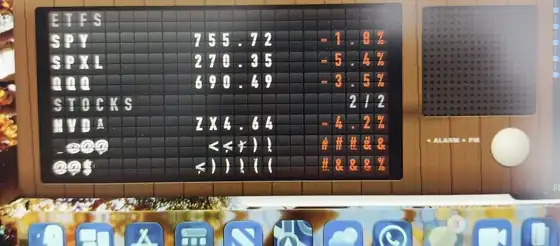
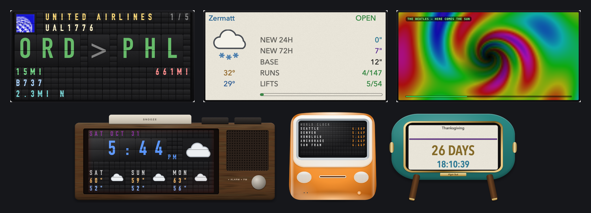

# ✈ Flight Clock for Mac and Windows

The [Flight Clock](https://github.com/RoyMan0/flight-clock-and-more) on your computer: no Raspberry Pi or LED panel needed. It shows the planes flying over your house, the time and weather, and any of 16 modules (sports, stocks, your calendar, ski reports, Now Playing, and more) in a window, in the menu bar or tray, or on your desktop behind everything else.





It can also look like things the LED panel can't:

- **Screens:** the classic **LED panel**, a vintage **airport flip board** (with the clatter, if you like), or a crisp **colour e-ink** page.
- **Cases:** an **80s bedside clock** in faux wood, a **mid-century desk clock**, a **vintage Mac SE** or an **iMac G3** in all its candy colours. Any screen in any case.
- **Music visualizers** for Now Playing, in the style of Winamp and the old iTunes visualizer, with ⏮ ⏯ ⏭ buttons on the clock for Spotify and Apple Music.

> **Want the real thing?** Build the LED version on a Raspberry Pi: parts list and one-command install at **[Flight Clock for Raspberry Pi](https://github.com/RoyMan0/flight-clock-and-more)**.

---

## Download

From the **[latest release](https://github.com/RoyMan0/Flight-Clock-App/releases/latest)**:

| Computer | Download | Needs |
|---|---|---|
| Mac with Apple Silicon (M1 or newer) | `FlightClock-<version>-AppleSilicon.dmg` | macOS 13 Ventura or later |
| Mac with an Intel chip | `FlightClock-<version>-Intel.dmg` | macOS 11 Big Sur or later |
| Windows PC | `FlightClock-Setup-<version>.exe` (or the portable `.zip`) | Windows 10 or 11, 64-bit |

Not sure which Mac you have? Apple menu → **About This Mac**: "Chip: Apple M…" is Apple Silicon.

## Install

### Mac

1. Open the DMG and drag **Flight Clock** onto **Applications**.
2. The first time you open it, macOS blocks it, because the app isn't signed with a paid Apple certificate yet. Click **Done**, then go to **System Settings → Privacy & Security**, scroll down, and click **Open Anyway** next to "Flight Clock was blocked". You only do this once.

### Windows

1. Run the Setup file. Windows says **"Windows protected your PC"** because the app isn't signed with a paid certificate: click **More info → Run anyway**. No admin password is needed.
2. If it asks for the **WebView2 Runtime** (most PCs already have it), install it from the link it shows and start Flight Clock again.

No installer wanted? Unzip the portable `.zip` anywhere and run `Flight Clock.exe`.

## Set up

The first time it opens, a setup page asks for:

- **Your location:** click **Use my Mac's/PC's location**, or type your address. It's how the clock finds planes over you and your weather.
- **Which modules to show.**
- **API keys:** optional and free. Planes overhead work without any; a free [Tomorrow.io](https://app.tomorrow.io/signup) key adds the weather, and free [AirLabs](https://airlabs.co/signup) / [FlightAware](https://www.flightaware.com/aeroapi/signup/personal) keys fill in more flight routes.

Click **Save & Start** and the clock appears.

## Using it

- **The ✈ icon** (menu bar on a Mac, system tray on Windows) opens the menu: show or hide the clock, Settings, show a module now, window mode, position (always on top, or on the desktop behind your windows), and style.
- **Right-click the clock** for the same menu. **Double-click** for full screen. Drag a corner to resize; the case keeps its shape.
- **Settings → Mac App / Windows App:** menu-bar or tray-only mode, open at login, and every style. *Browse all styles* shows every module in every screen and case.
- Every module has its own settings with a **Test** button that shows exactly what it will display.
- When a new version is out, the menu shows **Update Available**. Install it over the old one; your settings are kept (`~/Library/Application Support/Flight Clock` on a Mac, `%APPDATA%\Flight Clock` on Windows).

---

## Help, ideas and tips

**Need help?** Please [open an issue](https://github.com/RoyMan0/flight-clock-and-more/issues) on GitHub (the app and the Pi clock share one issue list). That's the best way to reach me, and the answer helps the next person with the same problem. Say whether it's the Mac or Windows app, what you were doing, and what happened.

Ideas are welcome too, as an issue or with **Issues? Ideas? Contact me!** at the bottom of the app's Settings page.

If you enjoy Flight Clock, tips are always appreciated:

| Venmo | PayPal |
|:---:|:---:|
|  |  |
| [@roy-hobbs](https://venmo.com/u/roy-hobbs) | [paypal.me/royman0](https://paypal.me/royman0) |

---

## Credits

Flight Clock grew out of **[plane-tracker-rgb-pi](https://github.com/c0wsaysmoo/plane-tracker-rgb-pi)** by **c0wsaysmoo**, which builds on **[its-a-plane-python](https://github.com/ColinWaddell/its-a-plane-python)** by **Colin Waddell**, with forks and ideas from **[a10kiloham](https://github.com/a10kiloham/plane-tracker-rgb-pi)**, **[yashmulgaonkar](https://github.com/yashmulgaonkar/plane-tracker-rgb-pi)** and **[ajplotkin](https://github.com/ajplotkin/plane-tracker-rgb-pi-f24only)**. Thank you all. On top of that I've added the module system and all the modules beyond the clock and flights, the setup wizard and config pages, and this app with its screens, cases and visualizers.

Built with [pywebview](https://pywebview.flowrl.com) and [PyInstaller](https://pyinstaller.org). Weather from [Tomorrow.io](https://www.tomorrow.io), aircraft positions from [adsb.lol](https://adsb.lol), [OpenSky](https://opensky-network.org) and [Flightradar24](https://www.flightradar24.com).

---

## License

[GPL-3.0](LICENSE), the same license as the original its-a-plane-python this project is built on.

<details>
<summary><strong>For developers</strong></summary>

The modules live in the Pi project, included here as the `core-src` submodule; this repo adds the Mac and Windows shells and the packaging. See [CLAUDE.md](CLAUDE.md) for how it fits together.

```bash
git clone --recurse-submodules https://github.com/RoyMan0/Flight-Clock-App
.venv/bin/python desktop/app.py      # run (uv-managed Python 3.12 in .venv)
packaging/build.sh                   # Mac: both DMGs; Windows builds on GitHub Actions
```
</details>
